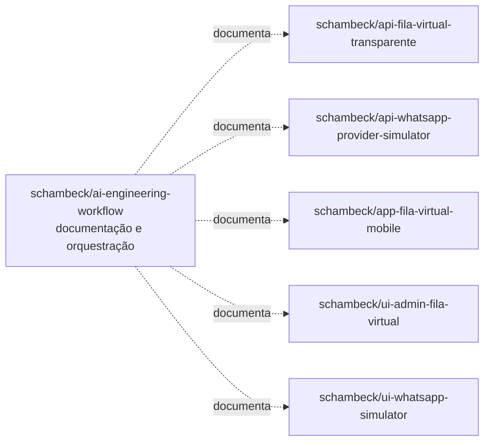

# Arquitetura da Fila Virtual Transparente

Este diretório centraliza a documentação de arquitetura da solução Fila Virtual
Transparente. O repositório `schambeck/ai-engineering-workflow` não hospeda os
aplicativos: ele funciona como fonte de documentação, especificações, prompts e
workflows compartilhados entre repositórios.

Os diagramas representam a arquitetura cross-repository. Elementos sem
confirmação em código ou contrato são identificados como **propostos** ou
**futuros**.

## Projetos documentados

| Projeto | Repositório | Papel |
| --- | --- | --- |
| `api-fila-virtual-transparente` | `schambeck/api-fila-virtual-transparente` | Backend principal da fila, conversas, pacientes, reservas e notificações. |
| `api-whatsapp-provider-simulator` | `schambeck/api-whatsapp-provider-simulator` | Simula um provedor WhatsApp, encaminhando mensagens recebidas por webhook e armazenando mensagens para polling. |
| `app-fila-virtual-mobile` | `schambeck/app-fila-virtual-mobile` | Aplicativo do paciente para identificação, consulta da fila, opções de atendimento e histórico. |
| `ui-admin-fila-virtual` | `schambeck/ui-admin-fila-virtual` | Interface administrativa da UBS para acompanhar a fila e chamar o próximo paciente. |
| `ui-whatsapp-simulator` | `schambeck/ui-whatsapp-simulator` | Interface de chat usada para simular a experiência do paciente no WhatsApp. |

## Índice dos diagramas

- [Contexto geral](context-diagram.md): atores, sistemas e limites da solução.
- [Containers](container-diagram.md): frontends, APIs, PostgreSQL e protocolos.
- [Backend principal](api-fila-virtual-transparente.md): componentes, sequências e estados.
- [Provider WhatsApp simulado](api-whatsapp-provider-simulator.md): componentes e fluxos de mensagens.
- [App mobile](app-fila-virtual-mobile.md): navegação e consulta da posição na fila.
- [Admin web](ui-admin-fila-virtual.md): componentes, dashboard e chamada do próximo paciente.
- [Simulador WhatsApp web](ui-whatsapp-simulator.md): componentes, envio e polling.
- [Deployment](deployment-diagram.md): ambientes local/dev e futuro.
- [Modelo de dados](data-model.md): entidades e relacionamentos conceituais.

## Convenções

- Setas contínuas representam chamadas de runtime.
- Setas tracejadas representam documentação, resposta assíncrona ou elemento
  futuro, conforme a legenda de cada diagrama.
- HTTP síncrono, webhook e polling são nomeados explicitamente nas conexões.
- O PostgreSQL pertence ao backend principal; acesso direto por frontend não é
  previsto.

## Como visualizar

O GitHub renderiza blocos `mermaid` diretamente na visualização dos arquivos
Markdown. Abra qualquer documento deste índice no GitHub. Em editores locais,
use uma extensão com suporte a Mermaid para pré-visualização de Markdown.
