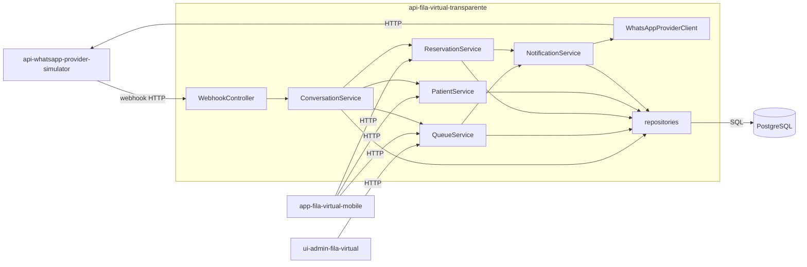
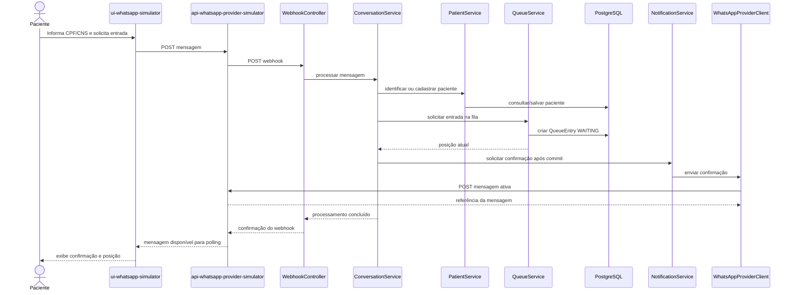
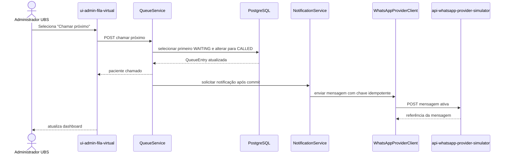
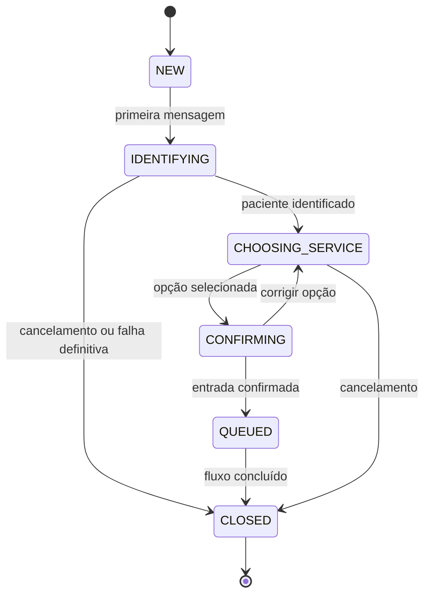
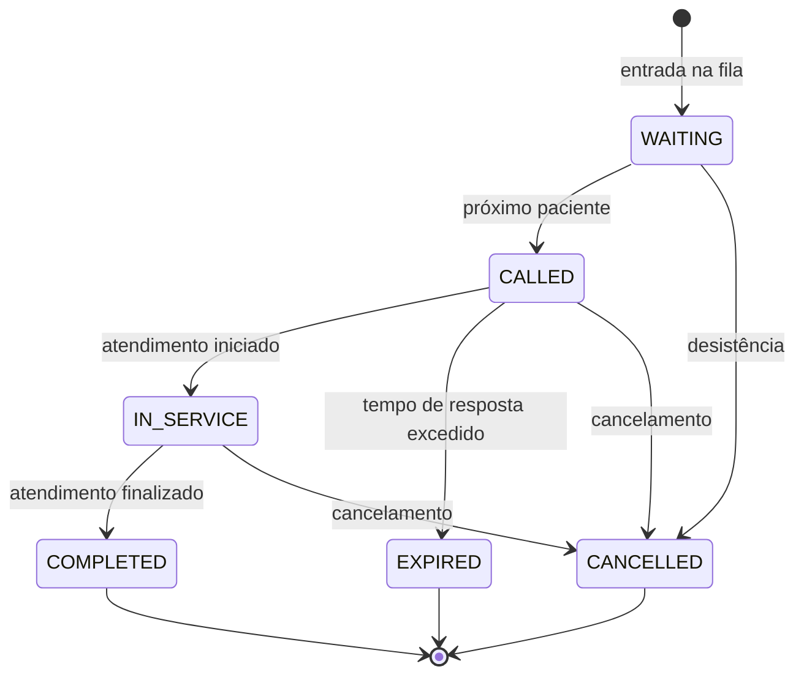

# Backend principal: api-fila-virtual-transparente

Repositório: `schambeck/api-fila-virtual-transparente`.

O backend principal é o núcleo transacional da solução. Os componentes abaixo
são uma visão lógica proposta a partir das responsabilidades esperadas; nomes e
fronteiras devem ser ajustados quando confrontados com o código do repositório.

## Componentes

## Entrada na fila via WhatsApp

## Chamada do próximo paciente

A alteração de `WAITING` para `CALLED` deve ser atômica. Falha de notificação
não desfaz a transição já confirmada e deve permitir nova tentativa, conforme o
contrato de fila deste repositório.

## Estados de Conversation

Esta máquina de estados é **proposta**, pois o contrato local não define os
estados de conversa.

## Estados de QueueEntry

Os estados e transições seguem o contrato
`specifications/api-fila-virtual-transparente/queue-flow.md`.

