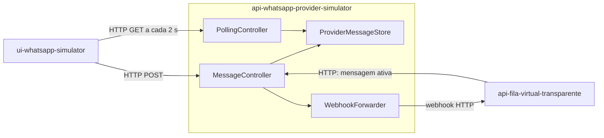
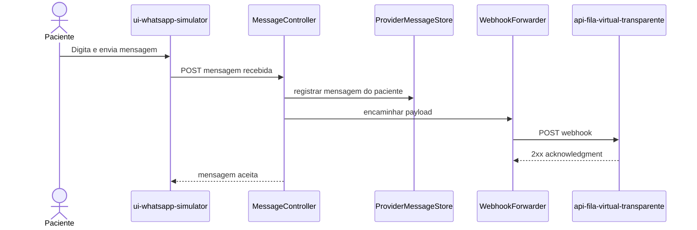
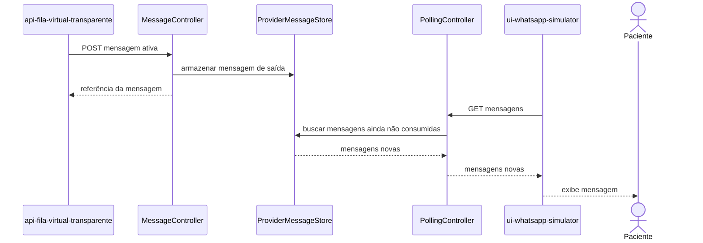
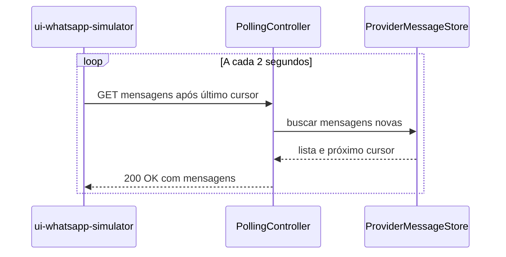

# Provider simulado: api-whatsapp-provider-simulator

Repositório: `schambeck/api-whatsapp-provider-simulator`.

O serviço simula a fronteira de um provedor WhatsApp. A decomposição abaixo é
**proposta** e evita acoplar o backend principal ao formato de um provedor real.

## Componentes

`ProviderMessageStore` pode ser inicialmente em memória no ambiente de
simulação. Persistência durável, retenção e concorrência são decisões a
confirmar no repositório do provider.

## Paciente envia mensagem

## Backend envia mensagem ativa

## Polling do simulador web

