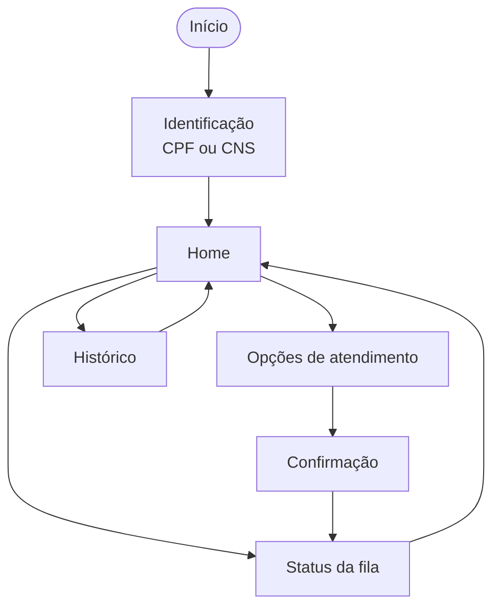
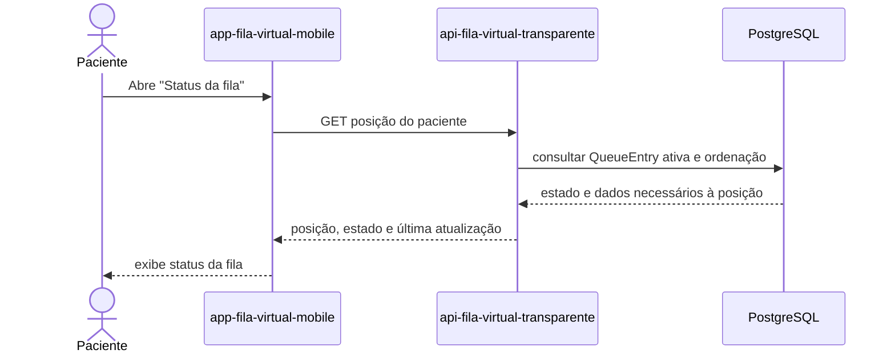
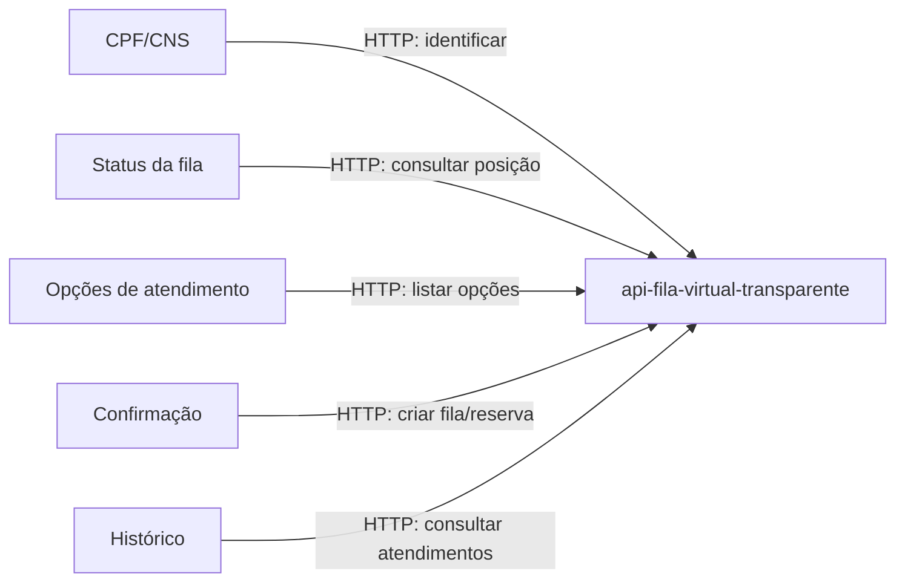

# Aplicativo: app-fila-virtual-mobile

Repositório: `schambeck/app-fila-virtual-mobile`.

O aplicativo oferece um canal complementar ao WhatsApp para o paciente. Telas,
rotas e contratos exatos são **propostos** até validação no repositório do app.

## Fluxo de navegação

## Consulta da posição na fila

## Relação entre telas e backend

Dados de outros pacientes não devem ser expostos na consulta de posição.
