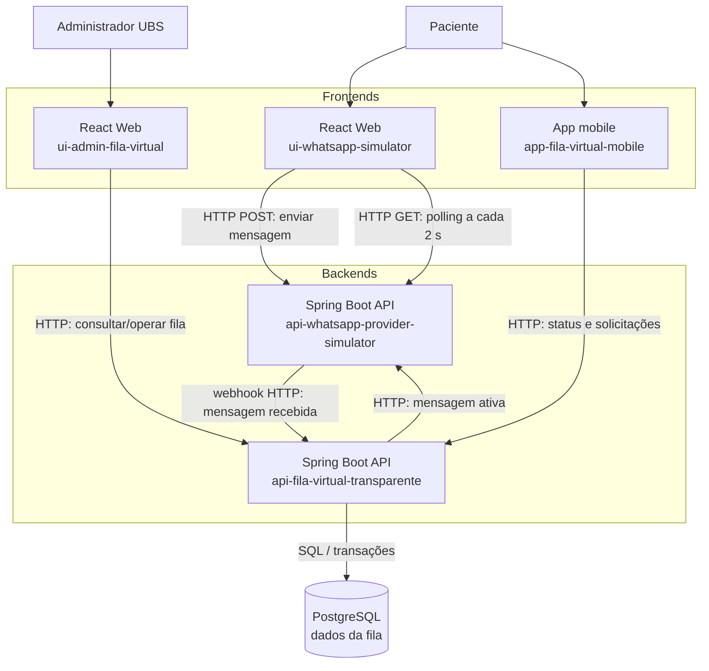

# Diagrama de containers

Os containers são distribuídos entre cinco repositórios de aplicação. O
PostgreSQL é acessado exclusivamente pelo backend principal.

## Protocolos

| Origem | Destino | Comunicação |
| --- | --- | --- |
| `ui-whatsapp-simulator` | `api-whatsapp-provider-simulator` | HTTP POST para envio e HTTP GET por polling a cada 2 segundos. |
| `api-whatsapp-provider-simulator` | `api-fila-virtual-transparente` | Webhook HTTP para mensagens recebidas. |
| `api-fila-virtual-transparente` | `api-whatsapp-provider-simulator` | HTTP para mensagens ativas e respostas ao paciente. |
| `ui-admin-fila-virtual` | `api-fila-virtual-transparente` | HTTP para dashboard e comandos administrativos. |
| `app-fila-virtual-mobile` | `api-fila-virtual-transparente` | HTTP para identificação, fila, reservas e histórico. |
| `api-fila-virtual-transparente` | PostgreSQL | Acesso transacional aos dados da solução. |
