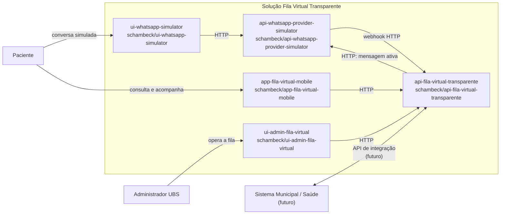

# Diagrama de contexto

O contexto abaixo mostra os usuários, os cinco projetos em repositórios
separados e uma integração municipal futura. O paciente pode usar o simulador
WhatsApp e, de forma complementar, o aplicativo mobile.

## Responsabilidades e chamadas

- O `ui-whatsapp-simulator` representa o canal do paciente e não acessa o
  backend principal diretamente.
- O `api-whatsapp-provider-simulator` recebe mensagens do simulador web,
  encaminha-as ao backend principal por webhook e disponibiliza mensagens de
  saída para polling.
- O `api-fila-virtual-transparente` concentra regras de negócio e persistência.
- O `ui-admin-fila-virtual` chama operações administrativas do backend por HTTP.
- O `app-fila-virtual-mobile` consulta e solicita operações do paciente por HTTP.
