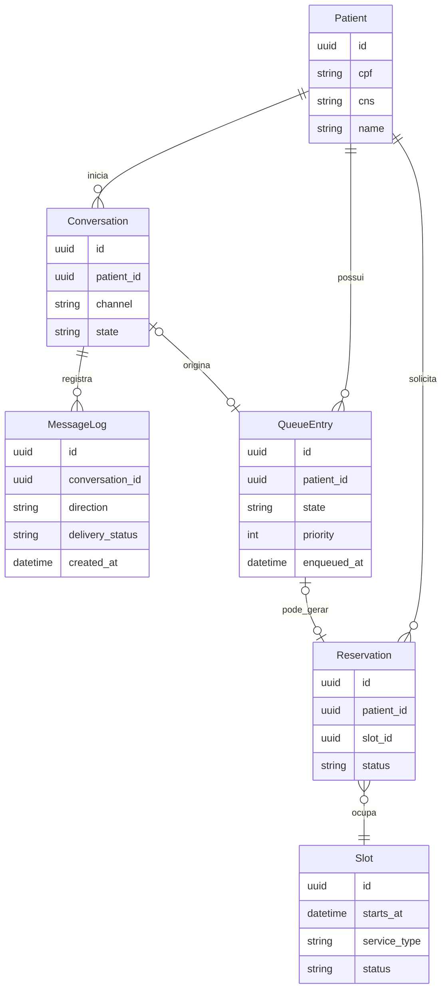
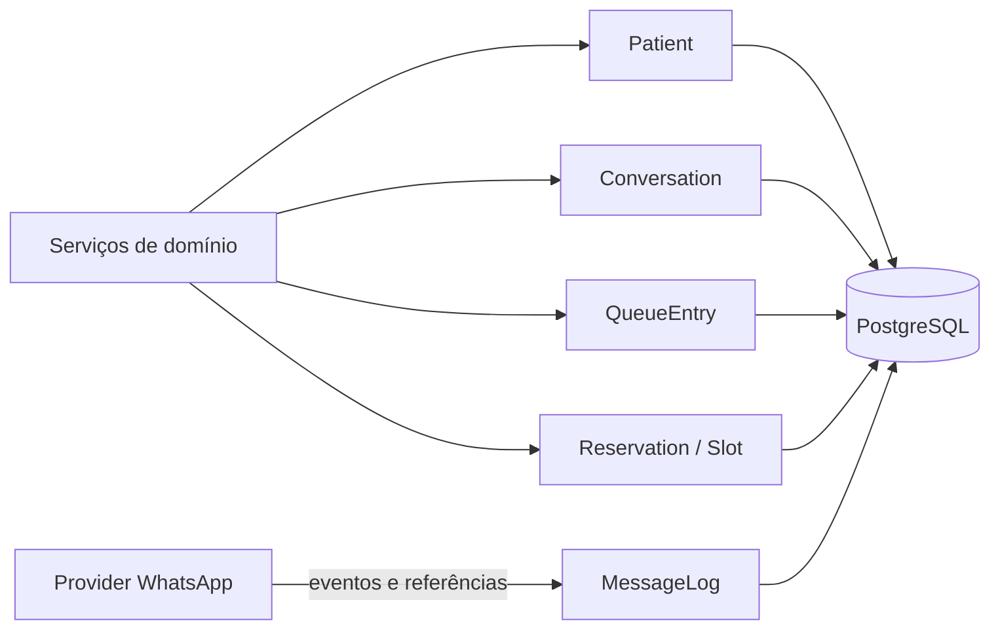

# Modelo de dados conceitual

O modelo abaixo é conceitual e pertence ao domínio do
`api-fila-virtual-transparente`. Tabelas, colunas, cardinalidades opcionais e
tipos devem ser confirmados no repositório da API e em suas migrações.

## Limites do modelo

- `QueueEntry.state` segue `WAITING`, `CALLED`, `IN_SERVICE`, `COMPLETED`,
  `CANCELLED` e `EXPIRED`.
- Estados de `Conversation`, reservas e slots são propostos e ainda precisam de
  contrato de domínio.
- Restrições de unicidade para CPF/CNS e uma entrada ativa por fila devem ser
  definidas ou confirmadas nas migrações.
