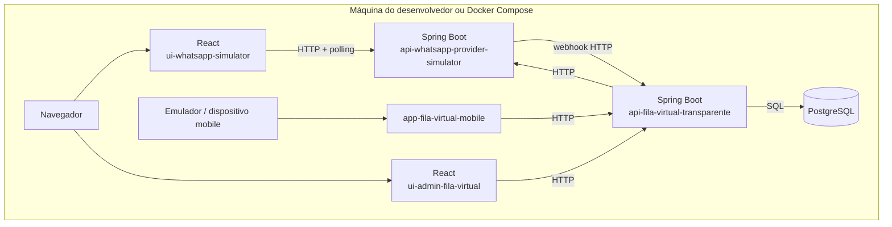
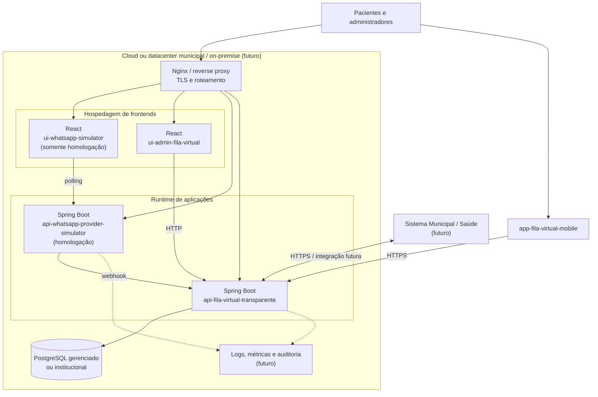

# Diagramas de deployment

Os diagramas separam a topologia local de desenvolvimento da topologia futura.
Portas, provedores de nuvem e ferramentas de empacotamento devem ser definidos
nos repositórios de aplicação.

## Local / desenvolvimento

## Futuro: cloud ou ambiente municipal/on-premise

Em produção, o simulador pode ser substituído por um provider WhatsApp real. O
reverse proxy, alta disponibilidade, gestão de segredos, backup e observabilidade
são elementos futuros.
