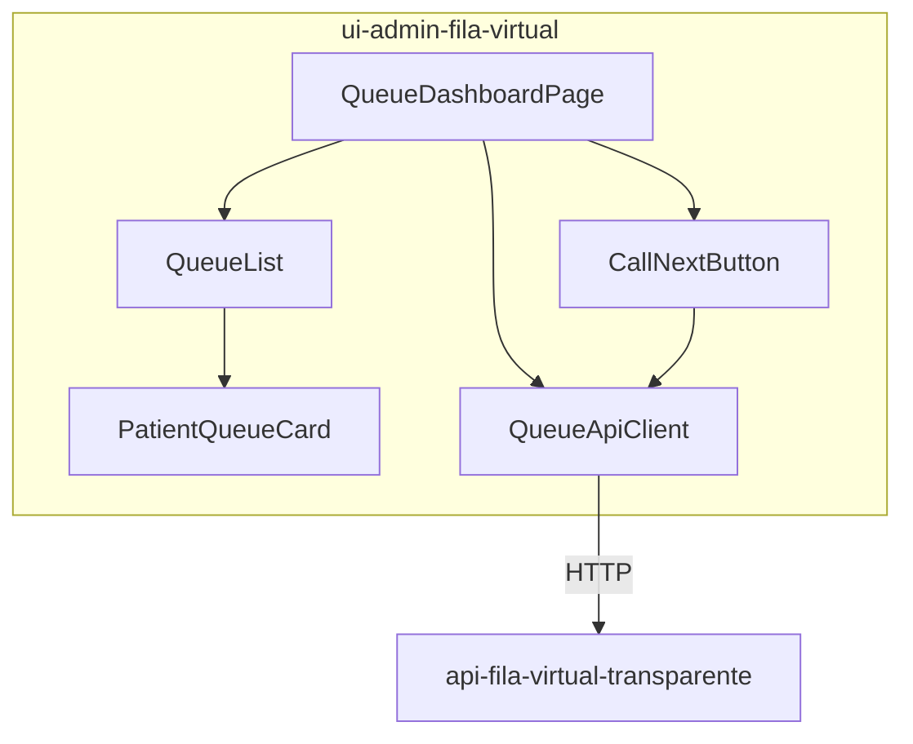
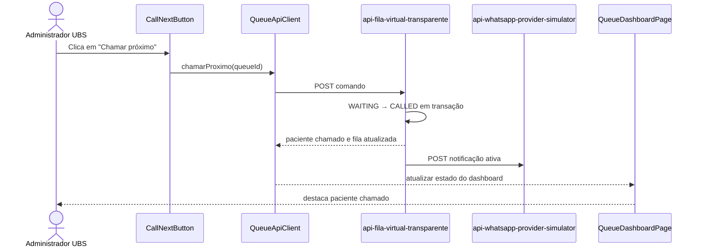
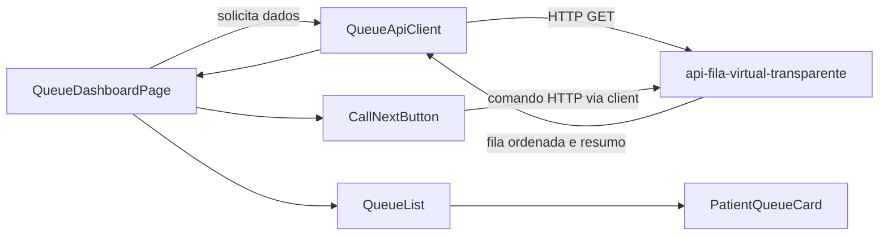

# Frontend administrativo: ui-admin-fila-virtual

Repositório: `schambeck/ui-admin-fila-virtual`.

O frontend administrativo permite à UBS visualizar a fila e executar comandos
autorizados. Os componentes são uma decomposição lógica **proposta**.

## Componentes

## Chamar próximo paciente

## Fluxo de dados do dashboard

Atualização automática do dashboard por polling, SSE ou WebSocket é uma decisão
**futura**. Até sua definição, o diagrama assume carga inicial e atualização
após comandos.
