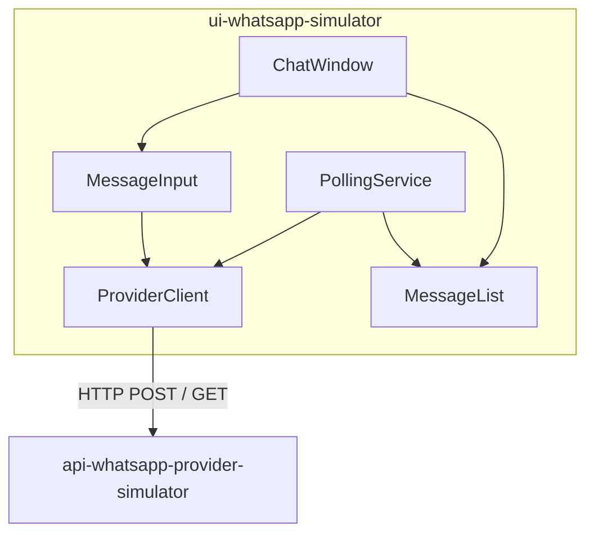
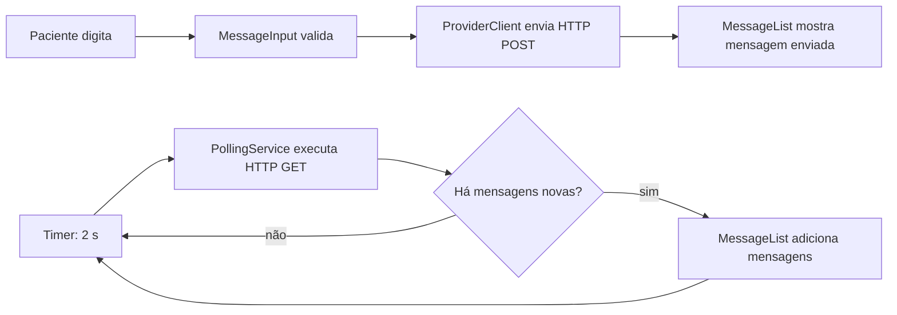
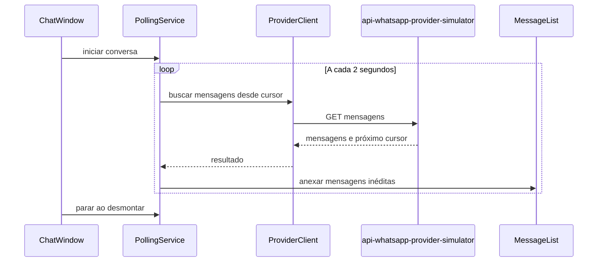

# Frontend: ui-whatsapp-simulator

Repositório: `schambeck/ui-whatsapp-simulator`.

Este frontend simula a interface usada pelo paciente no WhatsApp. Ele conversa
somente com o `api-whatsapp-provider-simulator`; o webhook para o backend
principal é responsabilidade do provider.

## Componentes

## Fluxos de envio e recebimento

O polling deve evitar duplicação por identificador ou cursor e ser interrompido
quando a tela não estiver ativa.

## Sequência de polling

